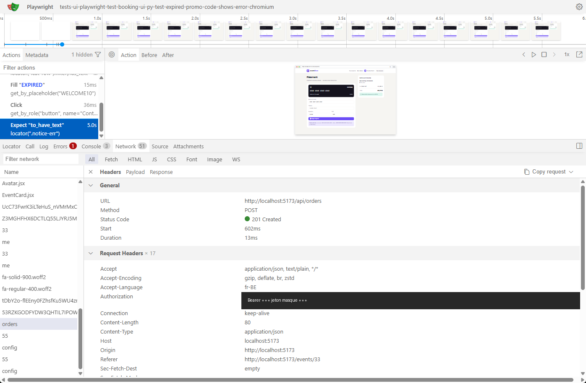

# Quête « Sold-Out » — Rapport de mission

Module 12 · lundi 23/11/2026 · branche `mission-lundi` · fork `Dapidu/EventFlowQA`

Ce rapport rassemble les preuves de chaque étape de la mission : commandes lancées, sorties obtenues, fichiers et lignes de code en cause.

## Sommaire

- [Préparation de l'équipement](#préparation-de-léquipement)
- **Partie A — Enquête sur les bugs**
  - [A1 · L'affaire du carré VIP (B1, pdb)](#a1--laffaire-du-carré-vip-b1-pdb)
  - [A2 · Le code promo zombie (B4, trace)](#a2--le-code-promo-zombie-b4-trace)
  - [A3 · Le dossier d'enquête (RCA et anomalie B4)](#a3--le-dossier-denquête-rca-et-anomalie-b4)
  - [A4 · Le test qui ne ment plus](#a4--le-test-qui-ne-ment-plus)
- **Partie B — Audit de sécurité du dépôt et du pipeline**
  - [B1 · La fouille du dépôt (audit outillé)](#b1--la-fouille-du-dépôt-audit-outillé)
  - B2 · Le rapport d'audit → [`docs/audit-securite.md`](../audit-securite.md)
  - [B3 · Blinder le pipeline](#b3--blinder-le-pipeline)

---

## Préparation de l'équipement

| Élément | Résultat |
|---|---|
| Docker Desktop | Prêt, conteneurs `db`, `backend`, `frontend` démarrés |
| Fork à jour | 0 commit de retard sur `BstormBe/EventFlow` (pas de « Sync fork » nécessaire) |
| Issues | Activées sur le fork |
| Actions | Workflows `CI` et `SonarQube Cloud` actifs |
| Branche | `mission-lundi` créée depuis `eventflow-qa` et poussée |
| `pytest tests/api -n auto` | **59 passed** |
| Outils | gitleaks 8.30.1 · pip-audit 2.10.1 · bandit 1.9.4 · zizmor 1.33.1 · cz 4.20.0 · `gh auth status` connecté |

**Environnement de la partie A :** mode bug activé (`SEED_BUGS=true docker compose up -d backend`, vérifié via `GET /api/config` → `{"seed_bugs": true}`).

> Les identifiants (événement, catégorie, commande) changent à chaque lancement : chaque session pytest crée un nouvel événement de test.

---

## A1 · L'affaire du carré VIP (B1, pdb)

**Bug B1 :** l'API accepte une commande qui dépasse les places restantes d'une catégorie (règle RM1).

### 1. Test lancé en mode pause sur échec

```powershell
cd qa
pytest tests/api/test_booking_rules.py::test_rm1_cannot_order_more_than_available_stock --pdb
```

Sortie :

```
>       assert r.status_code == 409, f"Sur-reservation acceptee (B1) : {r.text}"
E       AssertionError: Sur-reservation acceptee (B1) : {"id":49,"event_id":27,"status":"pending","total_cents":30000,...,"items":[{"category_id":81,"quantity":4,"unit_price_cents":7500}]}
E       assert 201 == 409
tests\api\test_booking_rules.py:36: AssertionError
```

Sans `-n` : avec xdist, les tests tournent dans des processus séparés qui n'ont pas accès au clavier, pdb ne peut pas fonctionner.

### 2. Valeurs inspectées dans pdb

```
(Pdb) p vip["available"]
3
(Pdb) p r.status_code
201
(Pdb) p r.json()["items"]
[{'category_id': 81, 'quantity': 4, 'unit_price_cents': 7500}]
```

| Question | Réponse |
|---|---|
| Places restantes (VIP, quota 3) | **3** |
| Billets commandés | **4** (`available + 1`) |
| Statut renvoyé par l'API | **201 Created** (commande acceptée) |
| Statut attendu par le test | **409 Conflict** (commande refusée) |
| `category_id` | 81 |

### 3. Vérification en base

```powershell
docker compose exec db psql -U eventflow -d eventflow -c "SELECT c.name, c.quota, SUM(oi.quantity) AS reserves FROM ticket_categories c JOIN order_items oi ON oi.category_id = c.id JOIN orders o ON o.id = oi.order_id WHERE c.id = 81 AND o.status IN ('pending', 'paid') GROUP BY c.name, c.quota;"
```

```
 name | quota | reserves
------+-------+----------
 VIP  |     3 |        4
(1 row)
```

**La base prouve la sur-réservation : 4 billets réservés pour un quota de 3.**

Piège : au même moment, l'API affiche pour cette catégorie `quota 3 · available 0`, et non `-1`. Le dépassement n'est visible que dans la base.

### 5. Cause dans le code

**Contrôle RM1** — `backend/app/routers/orders.py`, fonction `create_order`, lignes 99-100 :

```python
if item.quantity > category_available(db, category) and not settings.seed_bugs:
    raise HTTPException(status_code=409, detail=f"Not enough stock for {category.name}")
```

Pourquoi il ne refuse rien :

- `item.quantity > category_available(...)` → `4 > 3` → **True** : le dépassement est bien détecté ;
- `not settings.seed_bugs` → `not True` → **False** en mode bug ;
- `True and False` → **False** : le `raise` (409) n'est jamais exécuté.

**Calcul des places restantes** — `backend/app/services.py`, fonction `category_available`, lignes 47-48 :

```python
def category_available(db: Session, category: TicketCategory) -> int:
    return max(0, category.quota - category_sold(db, category.id))
```

Le calcul est correct. Le `max(0, …)` ramène `3 - 4 = -1` à **0** : c'est pourquoi l'API n'affiche jamais de valeur négative et masque le dépassement. `category_sold` (`services.py`, lignes 30-44) compte les billets des commandes `paid` et `pending`, comme la requête SQL.

### Conclusion A1

| Élément | Preuve |
|---|---|
| Symptôme | API : `201` au lieu de `409` pour 4 billets VIP alors qu'il en reste 3 |
| Impact | Base : quota 3, réservés 4 (sur-réservation) |
| Cause | `orders.py:99` : contrôle RM1 neutralisé par `and not settings.seed_bugs` |
| Masquage | `services.py:48` : `max(0, …)` affiche 0 au lieu de -1 |

---

## A2 · Le code promo zombie (B4, trace)

**Bug B4 :** le code promo `EXPIRED`, dont la date de validité est dépassée, est accepté ; le message « Promo code expired » n'apparaît pas.

### 1. Le test UI

`qa/tests/ui/playwright/test_booking_ui.py`, lignes 47-52, `test_expired_promo_code_shows_error` :

1. ouvre la page de l'événement de test, client déjà connecté (jeton injecté dans le localStorage par la fixture `logged_in_page`) ;
2. ajoute 1 billet « Plein tarif » ;
3. saisit `EXPIRED` dans le champ code promo (placeholder `WELCOME10`) ;
4. clique sur « Continuer vers le paiement » ;
5. attend un élément `.notice-err` contenant exactement « Promo code expired ».

```powershell
pytest tests/ui/playwright/test_booking_ui.py::test_expired_promo_code_shows_error -p no:rerunfailures
```

```
>       expect(logged_in_page.locator(".notice-err")).to_have_text("Promo code expired")
E       AssertionError: Locator expected to have text 'Promo code expired'
E       Actual value: None
E       Error: element(s) not found
E       Call log:
E         - Expect "to_have_text" locator(".notice-err") with timeout 5000ms
E         - waiting for locator(".notice-err")
tests\ui\playwright\test_booking_ui.py:52: AssertionError
FAILED tests/ui/playwright/test_booking_ui.py::test_expired_promo_code_shows_error[chromium]
```

Aucun message d'erreur n'apparaît dans les 5 secondes.

### 2. Test instable ?

| Lancement | Résultat |
|---|---|
| 1 | FAILED (`.notice-err` not found) |
| 2 | FAILED (`.notice-err` not found) |
| 3 | FAILED (`.notice-err` not found) |
| 4 | FAILED (`.notice-err` not found) |

**Non, ce n'est pas un test instable (flaky).** L'échec est reproductible à 100 %, avec le même message : c'est un vrai défaut. `-p no:rerunfailures` empêche le relancement automatique qui pourrait masquer le résultat.

### 3. Front ou back : l'API seule

```powershell
pytest "tests/api/test_booking_rules.py::test_rm4_promo_codes[EXPIRED]"
```

```
E       AssertionError: {"id":54,"event_id":32,"status":"pending","total_cents":5950,...,"items":[{"category_id":95,"quantity":2,"unit_price_cents":3500}]}
E       assert 201 == 400
FAILED tests/api/test_booking_rules.py::test_rm4_promo_codes[EXPIRED]
```

| | Statut |
|---|---|
| Renvoyé par l'API | **201 Created** (code accepté, remise appliquée : 2 × 3500 − 15 % = 5950) |
| Attendu par le test | **400 Bad Request** |

**Conclusion : sans navigateur, l'API accepte déjà le code expiré. Le défaut est côté back.** Le front n'affiche pas d'erreur parce que l'API ne lui en renvoie aucune.

### 4-5. Trace Playwright

```powershell
playwright show-trace reports/playwright/tests-ui-playwright-test-booking-ui-py-test-expired-promo-code-shows-error-chromium/trace.zip
```

Action `click` « Continuer vers le paiement » → onglet Network → `POST /api/orders` :

Requête :

```json
{"event_id":33,"items":[{"category_id":98,"quantity":1}],"promo_code":"EXPIRED"}
```

Réponse — statut **201** :

```json
{"id":55,"event_id":33,"status":"pending","total_cents":2975,"created_at":"2026-11-23T12:24:50.040038Z","expires_at":"2026-11-23T12:34:50.040666Z","items":[{"category_id":98,"quantity":1,"unit_price_cents":3500}]}
```

| Question | Réponse |
|---|---|
| Code promo envoyé | `EXPIRED` |
| Statut reçu | **201** |
| `total_cents` | **2975** |
| Remise appliquée ? | **Oui** : 3500 − 15 % = 2975 |
| Page suivante | **`/checkout/55`** (page de paiement) |
| Erreur dans la console ? | **Non** (seulement `[vite] connecting/connected` et l'info React DevTools) |

Le front se comporte correctement : il reçoit un 201 et passe au paiement.

*Capture : requête `POST /api/orders` et sa réponse dans le Trace Viewer (en-tête `Authorization` volontairement exclu).*


*Trace Viewer : `Fill "EXPIRED"` → `Click` « Continuer vers le paiement » → page Paiement `/checkout/55` à 29,75 € (remise appliquée) → `Expect "to_have_text"` sur `.notice-err` échoue après 5 s.*



*Trace Viewer, onglet Network : `POST /api/orders` envoyé avec le code EXPIRED, réponse **201 Created** (attendu : 400). En-tête `Authorization` masqué.*

### 6. Base de données et code

```powershell
docker compose exec db psql -U eventflow -d eventflow -c "SELECT code, percent_off, expires_at FROM promo_codes WHERE code = 'EXPIRED';"
```

```
  code   | percent_off |         expires_at
---------+-------------+----------------------------
 EXPIRED |          15 | 2026-11-22 07:19:04.894501
(1 row)
```

Le code a expiré le 22/11/2026 à 07:19 ; l'enquête a lieu le 23/11/2026 (`now()` en base : `2026-11-23 12:24`). La donnée est correcte.

**Validation du code promo** — `backend/app/routers/orders.py`, fonction `_validate_promo` (lignes 29-39), **ligne 34** :

```python
if promo.expires_at and promo.expires_at < datetime.utcnow() and not settings.seed_bugs:
    # BUG B4 (fil rouge): quand active, l'API accepte un code promo expire.
    raise HTTPException(status_code=400, detail="Promo code expired")
```

Pourquoi elle ne refuse pas :

- `promo.expires_at` → **True** (une date existe) ;
- `2026-11-22 07:19 < 2026-11-23` → **True** : l'expiration est bien détectée ;
- `not settings.seed_bugs` → **False** en mode bug ;
- `True and True and False` → **False** : le 400 « Promo code expired » n'est jamais renvoyé.

Le contrôle suivant (`used_count >= max_uses`, ligne 37) passe, `_validate_promo` renvoie le code, et `create_order` applique la remise (lignes 110-113).

### Conclusion A2

| Élément | Preuve |
|---|---|
| Symptôme UI | `.notice-err` introuvable, échec 4/4 (pas flaky) |
| Origine | Back : test API `assert 201 == 400` |
| Trace | `POST /api/orders` avec `EXPIRED` → 201, `total_cents` 2975 (remise appliquée), navigation vers `/checkout/55`, aucune erreur console |
| Donnée | `EXPIRED` expiré le 2026-11-22 07:19 |
| Cause | `orders.py:34` : contrôle d'expiration neutralisé par `and not settings.seed_bugs` |

---

## A3 · Le dossier d'enquête (RCA et anomalie B4)

| Livrable | Emplacement |
|---|---|
| Fiche RCA | [`docs/rca/B4.md`](../rca/B4.md) |
| Rapport d'anomalie | [issue #6](https://github.com/Dapidu/EventFlowQA/issues/6) — texte source [`docs/rca/B4-anomalie.md`](../rca/B4-anomalie.md) |

**Fréquence mesurée :** test UI 5 échecs sur 5, test API 4 échecs sur 4 (défaut systématique, pas un test instable).

**Gravité :** majeure, priorité haute (règle métier RM4 contournée, perte de 15 % par billet, vente flash mercredi).

**Cause racine (résumé des 5 Pourquoi) :**

1. Le test UI échoue → aucun message `.notice-err`, navigation vers `/checkout/55`.
2. Le front n'affiche rien → l'API répond `201` (trace : `total_cents` 2975).
3. L'API accepte → `orders.py:34`, le refus 400 est conditionné par `and not settings.seed_bugs`.
4. Une règle métier dépend d'un indicateur de configuration global (même schéma en `orders.py:82` et `orders.py:99`).
5. Le pipeline ne bloque pas → tests lancés avec `SEED_BUGS=false` par défaut (`ci.yml:17`) et tests UI en `continue-on-error: true` (`ci.yml:51`).

**Action concrète :** supprimer `continue-on-error: true` (`ci.yml:51`) et `and not settings.seed_bugs` (`orders.py:34`), puis rendre le statut CI obligatoire pour fusionner.

---

## A4 · Le test qui ne ment plus

### 1. Test de paiement : plus de relance ni d'attente fixe

`qa/tests/ui/playwright/test_checkout_e2e.py` (commit `3008219`) :

```diff
 import re
-import time

 import pytest
...
-@pytest.mark.flaky(reruns=3)
 def test_full_booking_flow_until_confirmation(logged_in_page: Page, qa_event):
...
     page.get_by_placeholder("Camille Client").fill("QA Bot")
-    time.sleep(2)  # le bouton payer ne marche pas toujours du premier coup, on attend un peu
     page.get_by_role("button", name=re.compile("^Payer")).click()
...
-@pytest.mark.flaky(reruns=3)
 def test_ticket_is_listed_in_my_tickets_after_payment(logged_in_page: Page, qa_event):
```

- `@pytest.mark.flaky(reruns=3)` relançait le test jusqu'à 3 fois : un défaut qui apparaît 1 fois sur 2 était déclaré « passed ». Le test mentait.
- `time.sleep(2)` est une attente aveugle : trop courte, le test échoue au hasard ; trop longue, elle ralentit la suite. Playwright attend déjà automatiquement que le bouton soit visible et cliquable avant `click()`, et `expect(...)` réessaie jusqu'au délai : l'attente fixe est inutile.
- `import time` n'est plus utilisé : supprimé.

### 2. Pipeline : les échecs UI font échouer le job

`.github/workflows/ci.yml` (commit `e2e15d6`) :

```diff
       - name: Tests UI Playwright
+        if: success() || failure()
         working-directory: qa
         run: pytest tests/ui/playwright -n 2 --alluredir=reports/allure-results
-        continue-on-error: true

       - name: Tests back-office Selenium
+        if: success() || failure()
         working-directory: qa
         run: pytest tests/ui/selenium_backoffice --alluredir=reports/allure-results --output reports/selenium
-        continue-on-error: true
```

| Situation | Avant (`continue-on-error: true`) | Après (`if: success() \|\| failure()`) |
|---|---|---|
| Tests API en échec | Étapes UI exécutées | Étapes UI exécutées (`failure()` vrai) |
| Test UI en échec | Étape marquée en échec, **mais job vert** | **Job rouge** |
| Run annulé (bouton Cancel, timeout) | — | Étapes UI **sautées** |

**Pourquoi pas `if: always()` ?** `always()` exécute l'étape même quand le run est **annulé** (bouton « Cancel workflow » ou dépassement de délai) : on lancerait des tests UI de plusieurs minutes alors que quelqu'un a demandé d'arrêter, et le run met plus longtemps à s'interrompre. `success() || failure()` couvre les deux cas utiles (étapes précédentes réussies ou échouées) et respecte l'annulation (`cancelled()`). Les étapes de rapport (Allure, upload) gardent `if: always()` : elles sont rapides et on veut le rapport dans tous les cas.

### 3. Vérification en mode normal

```powershell
$env:SEED_BUGS="false"; docker compose up -d backend     # GET /api/config -> seed_bugs = False
cd qa
pytest tests/ui/playwright
```

```
tests\ui\playwright\test_booking_ui.py .....
tests\ui\playwright\test_catalog_ui.py ....
tests\ui\playwright\test_checkout_e2e.py ..
tests\ui\playwright\test_login_ui.py .....
tests\ui\playwright\test_network_mocks.py ....
============================= 20 passed in 13.32s =============================
```

Stabilité sans filet (`-p no:rerunfailures`) : `test_checkout_e2e.py` **5 lancements sur 5 verts** (2 passed à chaque fois) ; suite complète en parallèle comme la CI (`-n 2`) : **20 passed**.

### 4. Commits et CI sur GitHub

Run CI déclenché par le push de `e2e15d6` : [run 45176407299](https://github.com/Dapidu/EventFlowQA/actions/runs/45176407299) — **success**, toutes les étapes vertes (Tests API, Tests UI Playwright, Tests back-office Selenium, Rapport Allure), sans `continue-on-error`.


```
e2e15d6 ci: les echecs UI font echouer le job
3008219 test(ui): retirer reruns et sleep du parcours de paiement
```

Pas de hook pre-commit installé sur ce clone (`.git/hooks` ne contient que les exemples) : aucun blocage Ruff.

---

## B1 · La fouille du dépôt (audit outillé)

Toutes les commandes sont lancées depuis la racine du dépôt. Sorties brutes complètes dans [`preuves/`](preuves/).

> **Objet maudit :** le secret trouvé n'a été ni lu, ni testé, ni copié. Toutes les sorties gitleaks sont produites avec `--redact`, et le contenu du commit en cause n'a jamais été affiché.

### 1. Secrets (gitleaks)

Configuration `.gitleaks.toml` à la racine (exclut `.venv/` et `node_modules/`). Attention au nom : sans le point initial (`gitleaks.toml`), gitleaks ne charge pas le fichier.

| Commande | Ce qui est scanné | Résultat | Preuve |
|---|---|---|---|
| `gitleaks dir --redact .` | les fichiers présents aujourd'hui sur le disque | `no leaks found` | [`B1-gitleaks-dir.txt`](preuves/B1-gitleaks-dir.txt) |
| `gitleaks git --redact -v .` | chaque commit de l'historique (41 commits) | `leaks found: 1` | [`B1-gitleaks-git.txt`](preuves/B1-gitleaks-git.txt) |

```
Finding:     CLIENT_SECRET = "REDACTED"
Secret:      REDACTED
RuleID:      generic-api-key
File:        qa/utils/xray_export.py
Line:        11
Commit:      cc428027178076c6b0fe5f125ffbf8b2a0ef4d5e
```

**Pourquoi les résultats diffèrent :** le fichier a été ajouté puis supprimé le même jour. `gitleaks dir` ne voit que l'état actuel, où le fichier n'existe plus ; `gitleaks git` relit tous les commits et trouve l'ajout.

```
$ git log --all --name-status -- qa/utils/xray_export.py
0a07c5c 2026-10-20 suppression script xray (pas utilise)     D  qa/utils/xray_export.py
cc42802 2026-10-20 feat: export des resultats vers Xray        A  qa/utils/xray_export.py
```

| Question | Réponse |
|---|---|
| Commit | `cc42802` (« feat: export des resultats vers Xray », 20/10/2026) |
| Fichier | `qa/utils/xray_export.py`, ligne 11, variable `CLIENT_SECRET` (règle `generic-api-key`) |
| Lisible aujourd'hui ? | **Oui.** Supprimer un fichier ne l'efface pas de l'historique : le commit est contenu dans `eventflow-qa`, `mission-lundi` et toutes les branches distantes (`git branch -a --contains cc42802`), l'objet existe toujours (`git cat-file -t cc42802:qa/utils/xray_export.py` → `blob`), et le dépôt est **public** sur GitHub : n'importe qui peut l'ouvrir, ainsi que dans chaque fork. |

**Traitement comme un vrai incident :** le secret est considéré comme compromis. La seule action efficace est de le **révoquer et le régénérer** côté Xray (propriétaire du compte). Réécrire l'historique (`git filter-repo`) ne suffit pas : les forks et clones existants en gardent une copie.

**`qa/.env` et `docker-compose.yml`** (valeurs non recopiées) :

| Fichier | Contenu sensible | Problème |
|---|---|---|
| `qa/.env` | `ADMIN_PASSWORD`, `ORGA_PASSWORD`, `CLIENT_PASSWORD`, `DB_URL` (identifiant et mot de passe de la base) | Fichier **suivi par Git** depuis `daac602` : `.gitignore` n'exclut que `backend/.env` et `frontend/.env` |
| `docker-compose.yml:6` | `POSTGRES_PASSWORD` en clair | Mot de passe de la base dans le dépôt |
| `docker-compose.yml:21` | `DATABASE_URL` avec identifiant et mot de passe | Idem |
| `docker-compose.yml:22` | `JWT_SECRET` (valeur par défaut de développement) | Quiconque connaît ce secret peut **fabriquer un jeton valide**, par exemple un jeton administrateur |

**gitleaks les a-t-il vus ? Non** : `gitleaks dir` renvoie `no leaks found` alors que ces fichiers sont présents. Ses règles détectent des formats connus et des valeurs à forte entropie ; des mots de passe simples passent sous le radar. Un scan vert ne prouve pas l'absence de secret.

### 2. Dépendances (pip-audit)

Preuve : [`B1-pip-audit.txt`](preuves/B1-pip-audit.txt) (fichier d'origine, puis après correction).

```
Found 6 known vulnerabilities in 1 package
Name     Version ID              Fix Versions
requests 2.31.0  PYSEC-2026-1873 2.32.0
requests 2.31.0  PYSEC-2026-1872 2.32.4
requests 2.31.0  PYSEC-2026-2275 2.33.0
(les 3 mêmes lignes répétées)
```

| Question | Réponse |
|---|---|
| Lignes affichées | **6** |
| Avis différents | **3** : `PYSEC-2026-1873`, `PYSEC-2026-1872`, `PYSEC-2026-2275` (chacun affiché deux fois) |
| Paquet | `requests` 2.31.0 (épinglé `==2.31.0`) |
| Version qui corrige | **2.33.0** (la plus haute des trois, corrige tous les avis) |
| Après `requests>=2.33.0` | `No known vulnerabilities found` (2.34.2 installée, 59 tests API verts) |

**Lignes sans version :** 12 sur 13 (`pytest`, `jsonschema`, `SQLAlchemy`, `psycopg2-binary`, `python-dotenv`, `PyJWT`, `pytest-html`, `pytest-playwright`, `pytest-rerunfailures`, `selenium`, `allure-pytest`, `pytest-xdist`).

Pourquoi c'est un problème :

- **Builds non reproductibles** : chaque `pip install` prend la dernière version du jour. La CI et le poste local peuvent tourner avec des versions différentes, un test peut casser sans qu'une ligne de code ait changé.
- **Chaîne d'approvisionnement** : une nouvelle version piégée ou cassée publiée sur PyPI entre automatiquement dans le projet.
- **Audit peu fiable** : pip-audit résout les versions au moment du scan ; il ne garantit pas que ce qui a été audité est ce qui sera installé demain.

Remède : un fichier de verrouillage (`pip-compile --generate-hashes` ou `pip freeze`) avec des versions exactes, mis à jour volontairement.

### 3. Code (bandit)

```
bandit -r qa -q -x qa/.venv
```

Preuve : [`B1-bandit.txt`](preuves/B1-bandit.txt). **109 constats**, regroupés par identifiant :

| Identifiant | Nombre | Où | Verdict |
|---|---|---|---|
| `B101` assert_used | 91 | tous les tests, `conftest.py:12`, `utils/factories.py:29,36` | **Faux positif.** pytest repose sur `assert`. Le risque (asserts supprimés par `python -O`) ne concerne que le code de production. |
| `B105` / `B107` hardcoded password | 6 + 1 | `test_auth.py:37,41`, `locustfile.py:58,59`, `factories.py:33` (mot de passe de comptes jetables) ; `test_promo.py:7,42` | **Faux positif** pour les comptes jetables créés par le test. **Vrai problème** pour `test_promo.py:7` et `:42` : mots de passe des comptes admin et client codés en dur, au lieu de passer par `utils/config` (`qa/.env`). |
| `B113` request_without_timeout | 8 | `test_promo.py` (×7), `utils/api_client.py:19` | **Vrai problème** : sans délai, une API qui ne répond plus bloque le test indéfiniment, et le job CI jusqu'à sa limite (6 h). |
| `B501` request_with_no_cert_validation (**High**) | 1 | `utils/api_client.py:22` (`verify=False`, aussi `session.verify = False` ligne 11) | **Vrai problème** : vérification TLS désactivée, une interception (homme du milieu) sur l'environnement de recette permet de voler identifiants et jetons. |
| `B608` hardcoded_sql_expressions | 1 | `utils/db.py:29` (`f"... WHERE o.id = {order_id}"`) | **Vrai problème** (risque faible ici) : requête SQL construite par f-string ; utiliser un paramètre lié (`:order_id`), comme le fait déjà `execute()`. |
| `B110` try_except_pass | 1 | `tests/api/test_promo.py:37` | **Vrai problème** : `try: ... assert ... except: pass` avale aussi l'`AssertionError`. `test_disable_promo` **ne peut jamais échouer** : c'est un test qui ment. |

Bonus relevé en lisant `test_promo.py` : la fonction `code_nul()` (ligne 48) ne commence pas par `test_`, pytest ne l'exécute jamais.

### 4. Workflow (zizmor)

```
zizmor --offline .github/workflows/ci.yml
```

Preuve : [`B1-zizmor.txt`](preuves/B1-zizmor.txt). `9 findings (3 suppressed)` → 6 affichés : 4 high, 1 medium, 1 low.

| Constat | Ligne | Risque (en une phrase) |
|---|---|---|
| `template-injection` (high) | `ci.yml:23` — `echo "Bugs du fil rouge : ${{ github.event.inputs.seed_bugs }}"` | Le texte saisi dans le champ `seed_bugs` est collé tel quel dans le script shell : une valeur contenant `"; <commande>; "` exécute n'importe quelle commande sur le runner, avec le jeton du dépôt. |
| `unpinned-uses` (high) | `ci.yml:19` `actions/checkout@v7`, `ci.yml:26` `actions/setup-python@v7`, `ci.yml:63` `actions/upload-artifact@v7` | Une étiquette `@v7` peut être déplacée : si le dépôt de l'action est compromis, du code malveillant s'exécute dans notre CI sans aucun changement de notre côté (attaque de la chaîne d'approvisionnement). |
| `excessive-permissions` (medium) | `ci.yml:14` — job `tests` sans bloc `permissions:` | Le `GITHUB_TOKEN` reçoit les permissions par défaut, potentiellement en écriture : une étape compromise pourrait pousser du code ou modifier le dépôt. |
| `artipacked` (low) | `ci.yml:19` — `actions/checkout@v7` sans `persist-credentials: false` | Le checkout laisse le jeton dans `.git/config` : si un jour le dossier entier est publié en artefact, le jeton fuit avec (ici seul `qa/reports/` est publié, d'où la confiance « Low »). |

---

## B3 · Blinder le pipeline

### Workflow `.github/workflows/ci.yml`

```diff
+permissions:
+  contents: read
+
 jobs:
   tests:
     ...
     steps:
-      - uses: actions/checkout@v7
+      - uses: actions/checkout@3d3c42e5aac5ba805825da76410c181273ba90b1 # v7.0.1
+        with:
+          persist-credentials: false

       - name: Demarrer EventFlow
         run: |
-          echo "Bugs du fil rouge : ${{ github.event.inputs.seed_bugs }}"
+          echo "Bugs du fil rouge : ${SEED_BUGS}"
...
-      - uses: actions/setup-python@v7
+      - uses: actions/setup-python@6d4fd22b20465ccc0f7354476588e8df7c9ca0e0 # v7.1.0
...
-        run: npx --yes allure generate reports/allure-results -o reports/allure-report
+        run: npx --yes allure@3.33.0 generate reports/allure-results -o reports/allure-report
...
-      - uses: actions/upload-artifact@v7
+      - uses: actions/upload-artifact@cf430e030ddbb5b0abf93d22962f4752f3646cd9 # v7.0.2
```

| Changement | Constat zizmor corrigé | Pourquoi ça protège |
|---|---|---|
| `permissions: contents: read` | `excessive-permissions` (`ci.yml:14`) | Le `GITHUB_TOKEN` ne peut plus que lire le code : une étape compromise ne peut ni pousser, ni modifier le dépôt. |
| `echo "… ${SEED_BUGS}"` | `template-injection` (`ci.yml:23`) | `${{ }}` est remplacé par GitHub **avant** l'exécution, en collant le texte dans le script. `${SEED_BUGS}` est lu par le shell **pendant** l'exécution, comme une simple valeur : le contenu n'est plus interprété comme du code. |
| Actions épinglées par SHA (+ version en commentaire) | `unpinned-uses` (`ci.yml:19, 26, 63`) | Un SHA désigne un commit précis et immuable ; une étiquette `v7` peut être déplacée. Le commentaire garde la version lisible pour les humains et pour Dependabot. |
| `persist-credentials: false` | `artipacked` (`ci.yml:19`) | Le jeton n'est plus écrit dans `.git/config` après le checkout. |
| `allure@3.33.0` | — | `npx --yes allure` téléchargeait la dernière version publiée à chaque run : même risque qu'une action non épinglée. |

SHA récupérés avec `gh` :

```
gh api repos/actions/checkout/commits/v7.0.1 --jq .sha        → 3d3c42e5aac5ba805825da76410c181273ba90b1
gh api repos/actions/setup-python/commits/v7.1.0 --jq .sha    → 6d4fd22b20465ccc0f7354476588e8df7c9ca0e0
gh api repos/actions/upload-artifact/commits/v7.0.2 --jq .sha → cf430e030ddbb5b0abf93d22962f4752f3646cd9
```

Vérification ([`B3-zizmor-apres.txt`](preuves/B3-zizmor-apres.txt)) :

```
zizmor --offline .github/workflows/ci.yml
No findings to report. Good job! (2 suppressed)
```

Avant : 6 constats affichés (4 high, 1 medium, 1 low). Après : **0**. Structure YAML vérifiée par chargement (`permissions: {'contents': 'read'}`, `with: {'persist-credentials': False}` bien rattaché au checkout).

### Dépendances `qa/requirements.txt`

```diff
-pytest
-requests>=2.33.0
-jsonschema
-SQLAlchemy
-psycopg2-binary
-python-dotenv
-PyJWT
-pytest-html
-pytest-playwright
-pytest-rerunfailures
-selenium
-allure-pytest
-pytest-xdist
+pytest==9.2.0
+requests==2.34.2
+jsonschema==4.26.0
+SQLAlchemy==2.1.9
+psycopg2-binary==2.9.13
+python-dotenv==1.2.4
+PyJWT==2.15.1
+pytest-html==4.2.0
+pytest-playwright==0.10.0
+pytest-rerunfailures==16.7
+selenium==4.53.0
+allure-pytest==2.16.2
+pytest-xdist==3.8.0
```

Versions relevées dans le venv `qa/.venv` (Python 3.12, comme la CI), **uniquement pour les 13 dépendances déclarées**. `pip freeze` brut donne 80 lignes : il inclut les outils d'audit installés le matin (bandit, pip-audit, zizmor, commitizen) et toutes les dépendances indirectes, qui n'ont pas leur place dans les dépendances de test.

Vérification ([`B3-pip-audit-apres.txt`](preuves/B3-pip-audit-apres.txt)) :

```
pip-audit -r qa/requirements.txt
No known vulnerabilities found
```

Non-régression : `pytest tests/api -n auto` → **59 passed**.
