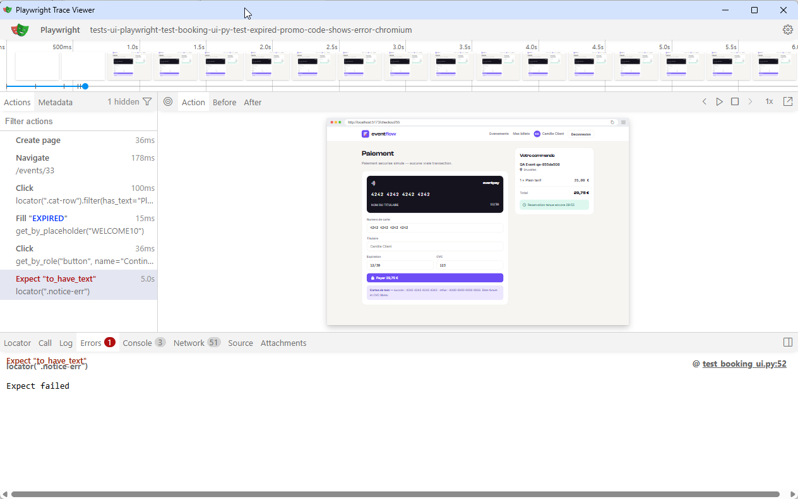

# Quête « Sold-Out » — Rapport de mission

Module 12 · lundi 23/11/2026 · branche `mission-lundi` · fork `Dapidu/EventFlowQA`

Ce rapport rassemble les preuves de chaque étape de la mission : commandes lancées, sorties obtenues, fichiers et lignes de code en cause.

## Sommaire

- [Préparation de l'équipement](#préparation-de-léquipement)
- **Partie A — Enquête sur les bugs**
  - [A1 · L'affaire du carré VIP (B1, pdb)](#a1--laffaire-du-carré-vip-b1-pdb)
  - [A2 · Le code promo zombie (B4, trace)](#a2--le-code-promo-zombie-b4-trace)
  - [A3 · Le dossier d'enquête (RCA et anomalie B4)](#a3--le-dossier-denquête-rca-et-anomalie-b4)
- **Partie B — Audit de sécurité du dépôt et du pipeline**
  - *à venir*

---

## Préparation de l'équipement

| Élément | Résultat |
|---|---|
| Docker Desktop | Prêt, conteneurs `db`, `backend`, `frontend` démarrés |
| Fork à jour | 0 commit de retard sur `BstormBe/EventFlow` (pas de « Sync fork » nécessaire) |
| Issues | Activées sur le fork |
| Actions | Workflows `CI` et `SonarQube Cloud` actifs |
| Branche | `mission-lundi` créée depuis `eventflow-qa` et poussée |
| `pytest tests/api -n auto` | **59 passed** |
| Outils | gitleaks 8.30.1 · pip-audit 2.10.1 · bandit 1.9.4 · zizmor 1.33.1 · cz 4.20.0 · `gh auth status` connecté |

**Environnement de la partie A :** mode bug activé (`SEED_BUGS=true docker compose up -d backend`, vérifié via `GET /api/config` → `{"seed_bugs": true}`).

> Les identifiants (événement, catégorie, commande) changent à chaque lancement : chaque session pytest crée un nouvel événement de test.

---

## A1 · L'affaire du carré VIP (B1, pdb)

**Bug B1 :** l'API accepte une commande qui dépasse les places restantes d'une catégorie (règle RM1).

### 1. Test lancé en mode pause sur échec

```powershell
cd qa
pytest tests/api/test_booking_rules.py::test_rm1_cannot_order_more_than_available_stock --pdb
```

Sortie :

```
>       assert r.status_code == 409, f"Sur-reservation acceptee (B1) : {r.text}"
E       AssertionError: Sur-reservation acceptee (B1) : {"id":49,"event_id":27,"status":"pending","total_cents":30000,...,"items":[{"category_id":81,"quantity":4,"unit_price_cents":7500}]}
E       assert 201 == 409
tests\api\test_booking_rules.py:36: AssertionError
```

Sans `-n` : avec xdist, les tests tournent dans des processus séparés qui n'ont pas accès au clavier, pdb ne peut pas fonctionner.

### 2. Valeurs inspectées dans pdb

```
(Pdb) p vip["available"]
3
(Pdb) p r.status_code
201
(Pdb) p r.json()["items"]
[{'category_id': 81, 'quantity': 4, 'unit_price_cents': 7500}]
```

| Question | Réponse |
|---|---|
| Places restantes (VIP, quota 3) | **3** |
| Billets commandés | **4** (`available + 1`) |
| Statut renvoyé par l'API | **201 Created** (commande acceptée) |
| Statut attendu par le test | **409 Conflict** (commande refusée) |
| `category_id` | 81 |

### 3. Vérification en base

```powershell
docker compose exec db psql -U eventflow -d eventflow -c "SELECT c.name, c.quota, SUM(oi.quantity) AS reserves FROM ticket_categories c JOIN order_items oi ON oi.category_id = c.id JOIN orders o ON o.id = oi.order_id WHERE c.id = 81 AND o.status IN ('pending', 'paid') GROUP BY c.name, c.quota;"
```

```
 name | quota | reserves
------+-------+----------
 VIP  |     3 |        4
(1 row)
```

**La base prouve la sur-réservation : 4 billets réservés pour un quota de 3.**

Piège : au même moment, l'API affiche pour cette catégorie `quota 3 · available 0`, et non `-1`. Le dépassement n'est visible que dans la base.

### 5. Cause dans le code

**Contrôle RM1** — `backend/app/routers/orders.py`, fonction `create_order`, lignes 99-100 :

```python
if item.quantity > category_available(db, category) and not settings.seed_bugs:
    raise HTTPException(status_code=409, detail=f"Not enough stock for {category.name}")
```

Pourquoi il ne refuse rien :

- `item.quantity > category_available(...)` → `4 > 3` → **True** : le dépassement est bien détecté ;
- `not settings.seed_bugs` → `not True` → **False** en mode bug ;
- `True and False` → **False** : le `raise` (409) n'est jamais exécuté.

**Calcul des places restantes** — `backend/app/services.py`, fonction `category_available`, lignes 47-48 :

```python
def category_available(db: Session, category: TicketCategory) -> int:
    return max(0, category.quota - category_sold(db, category.id))
```

Le calcul est correct. Le `max(0, …)` ramène `3 - 4 = -1` à **0** : c'est pourquoi l'API n'affiche jamais de valeur négative et masque le dépassement. `category_sold` (`services.py`, lignes 30-44) compte les billets des commandes `paid` et `pending`, comme la requête SQL.

### Conclusion A1

| Élément | Preuve |
|---|---|
| Symptôme | API : `201` au lieu de `409` pour 4 billets VIP alors qu'il en reste 3 |
| Impact | Base : quota 3, réservés 4 (sur-réservation) |
| Cause | `orders.py:99` : contrôle RM1 neutralisé par `and not settings.seed_bugs` |
| Masquage | `services.py:48` : `max(0, …)` affiche 0 au lieu de -1 |

---

## A2 · Le code promo zombie (B4, trace)

**Bug B4 :** le code promo `EXPIRED`, dont la date de validité est dépassée, est accepté ; le message « Promo code expired » n'apparaît pas.

### 1. Le test UI

`qa/tests/ui/playwright/test_booking_ui.py`, lignes 47-52, `test_expired_promo_code_shows_error` :

1. ouvre la page de l'événement de test, client déjà connecté (jeton injecté dans le localStorage par la fixture `logged_in_page`) ;
2. ajoute 1 billet « Plein tarif » ;
3. saisit `EXPIRED` dans le champ code promo (placeholder `WELCOME10`) ;
4. clique sur « Continuer vers le paiement » ;
5. attend un élément `.notice-err` contenant exactement « Promo code expired ».

```powershell
pytest tests/ui/playwright/test_booking_ui.py::test_expired_promo_code_shows_error -p no:rerunfailures
```

```
>       expect(logged_in_page.locator(".notice-err")).to_have_text("Promo code expired")
E       AssertionError: Locator expected to have text 'Promo code expired'
E       Actual value: None
E       Error: element(s) not found
E       Call log:
E         - Expect "to_have_text" locator(".notice-err") with timeout 5000ms
E         - waiting for locator(".notice-err")
tests\ui\playwright\test_booking_ui.py:52: AssertionError
FAILED tests/ui/playwright/test_booking_ui.py::test_expired_promo_code_shows_error[chromium]
```

Aucun message d'erreur n'apparaît dans les 5 secondes.

### 2. Test instable ?

| Lancement | Résultat |
|---|---|
| 1 | FAILED (`.notice-err` not found) |
| 2 | FAILED (`.notice-err` not found) |
| 3 | FAILED (`.notice-err` not found) |
| 4 | FAILED (`.notice-err` not found) |

**Non, ce n'est pas un test instable (flaky).** L'échec est reproductible à 100 %, avec le même message : c'est un vrai défaut. `-p no:rerunfailures` empêche le relancement automatique qui pourrait masquer le résultat.

### 3. Front ou back : l'API seule

```powershell
pytest "tests/api/test_booking_rules.py::test_rm4_promo_codes[EXPIRED]"
```

```
E       AssertionError: {"id":54,"event_id":32,"status":"pending","total_cents":5950,...,"items":[{"category_id":95,"quantity":2,"unit_price_cents":3500}]}
E       assert 201 == 400
FAILED tests/api/test_booking_rules.py::test_rm4_promo_codes[EXPIRED]
```

| | Statut |
|---|---|
| Renvoyé par l'API | **201 Created** (code accepté, remise appliquée : 2 × 3500 − 15 % = 5950) |
| Attendu par le test | **400 Bad Request** |

**Conclusion : sans navigateur, l'API accepte déjà le code expiré. Le défaut est côté back.** Le front n'affiche pas d'erreur parce que l'API ne lui en renvoie aucune.

### 4-5. Trace Playwright

```powershell
playwright show-trace reports/playwright/tests-ui-playwright-test-booking-ui-py-test-expired-promo-code-shows-error-chromium/trace.zip
```

Action `click` « Continuer vers le paiement » → onglet Network → `POST /api/orders` :

Requête :

```json
{"event_id":33,"items":[{"category_id":98,"quantity":1}],"promo_code":"EXPIRED"}
```

Réponse — statut **201** :

```json
{"id":55,"event_id":33,"status":"pending","total_cents":2975,"created_at":"2026-11-23T12:24:50.040038Z","expires_at":"2026-11-23T12:34:50.040666Z","items":[{"category_id":98,"quantity":1,"unit_price_cents":3500}]}
```

| Question | Réponse |
|---|---|
| Code promo envoyé | `EXPIRED` |
| Statut reçu | **201** |
| `total_cents` | **2975** |
| Remise appliquée ? | **Oui** : 3500 − 15 % = 2975 |
| Page suivante | **`/checkout/55`** (page de paiement) |
| Erreur dans la console ? | **Non** (seulement `[vite] connecting/connected` et l'info React DevTools) |

Le front se comporte correctement : il reçoit un 201 et passe au paiement.

*Capture : requête `POST /api/orders` et sa réponse dans le Trace Viewer (en-tête `Authorization` volontairement exclu).*

<!-- Insérer ici la capture :  -->

### 6. Base de données et code

```powershell
docker compose exec db psql -U eventflow -d eventflow -c "SELECT code, percent_off, expires_at FROM promo_codes WHERE code = 'EXPIRED';"
```

```
  code   | percent_off |         expires_at
---------+-------------+----------------------------
 EXPIRED |          15 | 2026-11-22 07:19:04.894501
(1 row)
```

Le code a expiré le 22/11/2026 à 07:19 ; l'enquête a lieu le 23/11/2026 (`now()` en base : `2026-11-23 12:24`). La donnée est correcte.

**Validation du code promo** — `backend/app/routers/orders.py`, fonction `_validate_promo` (lignes 29-39), **ligne 34** :

```python
if promo.expires_at and promo.expires_at < datetime.utcnow() and not settings.seed_bugs:
    # BUG B4 (fil rouge): quand active, l'API accepte un code promo expire.
    raise HTTPException(status_code=400, detail="Promo code expired")
```

Pourquoi elle ne refuse pas :

- `promo.expires_at` → **True** (une date existe) ;
- `2026-11-22 07:19 < 2026-11-23` → **True** : l'expiration est bien détectée ;
- `not settings.seed_bugs` → **False** en mode bug ;
- `True and True and False` → **False** : le 400 « Promo code expired » n'est jamais renvoyé.

Le contrôle suivant (`used_count >= max_uses`, ligne 37) passe, `_validate_promo` renvoie le code, et `create_order` applique la remise (lignes 110-113).

### Conclusion A2

| Élément | Preuve |
|---|---|
| Symptôme UI | `.notice-err` introuvable, échec 4/4 (pas flaky) |
| Origine | Back : test API `assert 201 == 400` |
| Trace | `POST /api/orders` avec `EXPIRED` → 201, `total_cents` 2975 (remise appliquée), navigation vers `/checkout/55`, aucune erreur console |
| Donnée | `EXPIRED` expiré le 2026-11-22 07:19 |
| Cause | `orders.py:34` : contrôle d'expiration neutralisé par `and not settings.seed_bugs` |

---

## A3 · Le dossier d'enquête (RCA et anomalie B4)

| Livrable | Emplacement |
|---|---|
| Fiche RCA | [`docs/rca/B4.md`](../rca/B4.md) |
| Rapport d'anomalie | [issue #6](https://github.com/Dapidu/EventFlowQA/issues/6) — texte source [`docs/rca/B4-anomalie.md`](../rca/B4-anomalie.md) |

**Fréquence mesurée :** test UI 5 échecs sur 5, test API 4 échecs sur 4 (défaut systématique, pas un test instable).

**Gravité :** majeure, priorité haute (règle métier RM4 contournée, perte de 15 % par billet, vente flash mercredi).

**Cause racine (résumé des 5 Pourquoi) :**

1. Le test UI échoue → aucun message `.notice-err`, navigation vers `/checkout/55`.
2. Le front n'affiche rien → l'API répond `201` (trace : `total_cents` 2975).
3. L'API accepte → `orders.py:34`, le refus 400 est conditionné par `and not settings.seed_bugs`.
4. Une règle métier dépend d'un indicateur de configuration global (même schéma en `orders.py:82` et `orders.py:99`).
5. Le pipeline ne bloque pas → tests lancés avec `SEED_BUGS=false` par défaut (`ci.yml:17`) et tests UI en `continue-on-error: true` (`ci.yml:51`).

**Action concrète :** supprimer `continue-on-error: true` (`ci.yml:51`) et `and not settings.seed_bugs` (`orders.py:34`), puis rendre le statut CI obligatoire pour fusionner.
