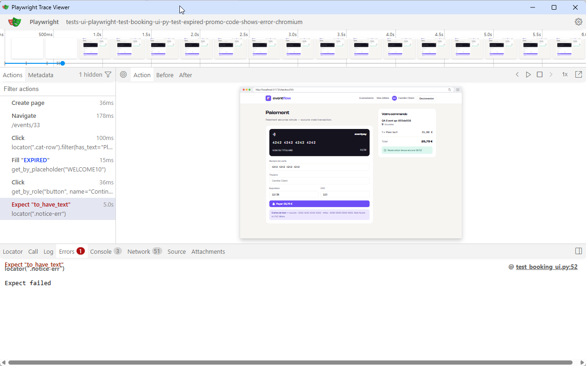

## Environnement

- **Dépôt / branche :** `Dapidu/EventFlowQA`, branche `mission-lundi` (créée depuis `eventflow-qa`)
- **Mode bug :** activé (`SEED_BUGS=true`, vérifié via `GET /api/config` → `{"seed_bugs": true}`)
- **Navigateur :** Chromium 159.0.8154.6 (Playwright 1.65.2, headless), locale `fr-BE`, fenêtre 1366 × 900
- **Application :** lancée avec `docker compose up -d --build` (PostgreSQL 16, API FastAPI, front React/Vite sur http://localhost:5173)
- **Date :** 23/11/2026

## Étapes pour reproduire

1. Démarrer l'application en mode bug : `$env:SEED_BUGS="true"; docker compose up -d --build`.
2. Ouvrir http://localhost:5173 dans un navigateur.
3. Cliquer sur « Connexion » et se connecter avec le compte client de démonstration (`client@eventflow.test`, mot de passe : voir le tableau « Données de démonstration » du README).
4. Dans le catalogue, ouvrir n'importe quel événement publié.
5. Sur la ligne « Plein tarif », cliquer une fois sur le bouton **+** (1 billet).
6. Dans le champ « Code promo » (texte d'exemple `WELCOME10`), saisir `EXPIRED`.
7. Cliquer sur **Continuer vers le paiement**.

## Résultat attendu

- Un message d'erreur « Promo code expired » s'affiche sur la page de l'événement.
- L'utilisateur reste sur la page de l'événement, aucune commande n'est créée.
- Côté API : `POST /api/orders` répond **400** `{"detail": "Promo code expired"}` (règle RM4).

## Résultat obtenu

- Aucun message d'erreur.
- L'utilisateur est redirigé vers la page de paiement (`/checkout/<id>`), une commande `pending` est créée.
- La remise de 15 % du code expiré est appliquée : `total_cents` = **2975** au lieu de 3500.
- Côté API : `POST /api/orders` répond **201 Created**. Aucune erreur dans la console du navigateur.

## Fréquence

Systématique (100 %) :

- test UI `test_expired_promo_code_shows_error` (avec `-p no:rerunfailures`) : **5 échecs sur 5** ;
- test API `test_rm4_promo_codes[EXPIRED]` : **4 échecs sur 4**.

Ce n'est pas un test instable : même message d'échec à chaque lancement.

## Gravité

**Majeure** — priorité **haute**.

- Une règle métier (RM4 : un code promo a une date d'expiration) est contournée : l'entreprise perd 15 % du prix sur chaque billet vendu avec un code périmé, et ne peut plus mettre fin à une promotion.
- Défaut silencieux : ni le client ni le support ne voient d'erreur, il n'est détectable qu'en comptabilité.
- Priorité haute car la vente flash du festival ouvre mercredi : un ancien code partagé publiquement peut être utilisé massivement.
- Pas « bloquante » : le parcours d'achat fonctionne et aucune donnée n'est corrompue ou exposée.

## Preuves

**Trace Playwright** (`qa/reports/playwright/tests-ui-playwright-test-booking-ui-py-test-expired-promo-code-shows-error-chromium/trace.zip`), action « Continuer vers le paiement » → Network → `POST /api/orders` :

- requête : `{"event_id":33,"items":[{"category_id":98,"quantity":1}],"promo_code":"EXPIRED"}`
- réponse : `201`, `{"id":55,"status":"pending","total_cents":2975,"items":[{"category_id":98,"quantity":1,"unit_price_cents":3500}], ...}`
- page suivante : `/checkout/55`



**Base de données** — le code est bien expiré :

```
  code   | percent_off |         expires_at
---------+-------------+----------------------------
 EXPIRED |          15 | 2026-11-22 07:19:04.894501
```

**Ligne de code** — `backend/app/routers/orders.py:34`, fonction `_validate_promo` :

```python
if promo.expires_at and promo.expires_at < datetime.utcnow() and not settings.seed_bugs:
    raise HTTPException(status_code=400, detail="Promo code expired")
```

En mode bug, `not settings.seed_bugs` vaut `False` : le refus 400 n'est jamais exécuté.

**Analyse complète :** fiche RCA `docs/rca/B4.md` (branche `mission-lundi`).
