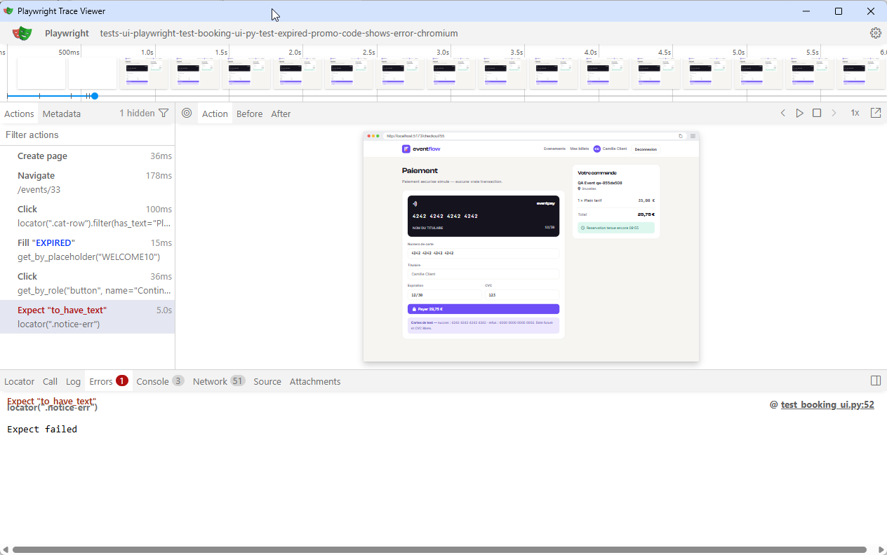
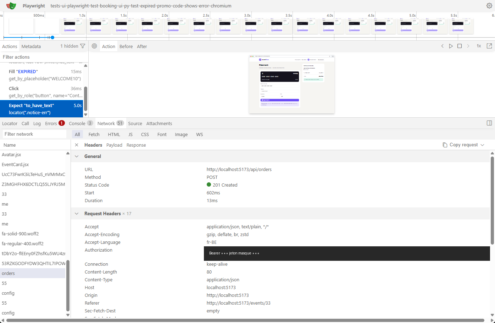

# RCA B4 : un code promo expiré est accepté et donne encore sa remise

## Symptôme observé

Sur la page d'un événement, un client saisit le code promo `EXPIRED` (date de validité dépassée) puis clique sur « Continuer vers le paiement ». Aucun message « Promo code expired » n'apparaît : le client arrive sur la page de paiement avec la remise de 15 % appliquée.

Le test UI `test_expired_promo_code_shows_error` échoue (`.notice-err` introuvable), ainsi que le test API `test_rm4_promo_codes[EXPIRED]` (`201` au lieu de `400`).

Contexte : branche `mission-lundi`, mode bug activé (`SEED_BUGS=true`), 23/11/2026.

Rapport d'anomalie : [issue #6](https://github.com/Dapidu/EventFlowQA/issues/6) (texte source : [`B4-anomalie.md`](B4-anomalie.md)).

## Impact (pour l'utilisateur, pour l'entreprise)

**Pour l'utilisateur**

- Comportement incohérent : un code annoncé comme terminé fonctionne encore. Le jour où le défaut sera corrigé, des clients qui comptaient sur ce code verront leur commande refusée sans comprendre pourquoi.
- Inégalité entre clients : ceux qui connaissent un ancien code paient moins cher que les autres pour la même place.

**Pour l'entreprise**

- Perte de chiffre d'affaires directe : 15 % de remise par billet (525 centimes sur un billet à 3500), sur chaque commande utilisant un code périmé.
- Risque amplifié par la vente flash du festival de mercredi : un code expiré qui circule sur les réseaux sociaux peut être utilisé massivement en quelques minutes.
- Fin de campagne commerciale impossible à garantir : la date d'expiration d'un code n'a plus aucun effet, l'organisateur ne contrôle plus ses promotions.
- Défaut silencieux : aucune erreur côté client, aucune erreur en console, la commande est enregistrée normalement. Il n'est détectable que par les tests ou par une analyse comptable a posteriori.

## Preuves (commandes, résultats, capture de la trace, ligne de code)

**1. Test UI — échec reproductible**

```powershell
pytest tests/ui/playwright/test_booking_ui.py::test_expired_promo_code_shows_error -p no:rerunfailures
```

```
E       AssertionError: Locator expected to have text 'Promo code expired'
E       Actual value: None
E       Error: element(s) not found
E         - Expect "to_have_text" locator(".notice-err") with timeout 5000ms
FAILED tests/ui/playwright/test_booking_ui.py::test_expired_promo_code_shows_error[chromium]
```

Fréquence : 5 échecs sur 5 lancements, toujours le même message (pas un test instable).

**2. Test API — le back accepte le code**

```powershell
pytest "tests/api/test_booking_rules.py::test_rm4_promo_codes[EXPIRED]"
```

```
E       AssertionError: {"id":54,"event_id":32,"status":"pending","total_cents":5950,...}
E       assert 201 == 400
```

Fréquence : 4 échecs sur 4 lancements. Remise appliquée : 2 × 3500 − 15 % = 5950.

**3. Trace Playwright — requête `POST /api/orders`**

```powershell
playwright show-trace reports/playwright/tests-ui-playwright-test-booking-ui-py-test-expired-promo-code-shows-error-chromium/trace.zip
```

- Requête : `{"event_id":33,"items":[{"category_id":98,"quantity":1}],"promo_code":"EXPIRED"}`
- Réponse : statut **201**, `"total_cents":2975` (3500 − 15 %), `"status":"pending"`
- Navigation suivante : `/checkout/55` (page de paiement)
- Console : aucune erreur (uniquement `[vite] connected` et l'info React DevTools)



*Trace Viewer : actions `Fill "EXPIRED"` → `Click` « Continuer vers le paiement » → l'utilisateur arrive sur `/checkout/55` (page Paiement, total 29,75 € avec la remise de 15 %) → `Expect "to_have_text"` sur `.notice-err` échoue après 5 s.*



*Trace Viewer, onglet Network : `POST /api/orders` envoyé avec le code EXPIRED, réponse **201 Created** (attendu : 400). En-tête `Authorization` masqué.*

**4. Base de données — la donnée est correcte**

```powershell
docker compose exec db psql -U eventflow -d eventflow -c "SELECT code, percent_off, expires_at FROM promo_codes WHERE code = 'EXPIRED';"
```

```
  code   | percent_off |         expires_at
---------+-------------+----------------------------
 EXPIRED |          15 | 2026-11-22 07:19:04.894501
```

`now()` en base au moment du test : `2026-11-23 12:24`. Le code est bien expiré depuis la veille.

**5. Ligne de code — `backend/app/routers/orders.py:34`, fonction `_validate_promo`**

```python
if promo.expires_at and promo.expires_at < datetime.utcnow() and not settings.seed_bugs:
    # BUG B4 (fil rouge): quand active, l'API accepte un code promo expire.
    raise HTTPException(status_code=400, detail="Promo code expired")
```

**6. Pipeline — `.github/workflows/ci.yml`**

```yaml
17:  SEED_BUGS: ${{ github.event.inputs.seed_bugs || 'false' }}
...
48:  - name: Tests UI Playwright
50:    run: pytest tests/ui/playwright -n 2 --alluredir=reports/allure-results
51:    continue-on-error: true
```

## 5 Pourquoi

| Pourquoi | Réponse | Preuve |
|---|---|---|
| 1. Pourquoi le test UI échoue-t-il ? | Le message d'erreur `.notice-err` « Promo code expired » n'apparaît jamais : la page passe directement au paiement. | Sortie pytest : `element(s) not found` après 5 s ; trace : navigation vers `/checkout/55`. |
| 2. Pourquoi le front n'affiche-t-il pas d'erreur ? | Parce que l'API ne lui en renvoie aucune : elle répond `201 Created` avec la remise appliquée. Le front fait ce qu'il doit faire avec un 201. Le défaut est côté back. | Trace, onglet Network : `POST /api/orders` → `201`, `total_cents: 2975` ; console sans erreur ; test API seul : `assert 201 == 400`. |
| 3. Pourquoi l'API accepte-t-elle le code alors qu'il est expiré ? | Le contrôle d'expiration de `_validate_promo` détecte bien l'expiration, mais le `raise` 400 est conditionné par `and not settings.seed_bugs`. En mode bug, la condition devient `True and True and False` = `False` : le refus n'est jamais exécuté. | `orders.py:34` ; SQL : `expires_at = 2026-11-22 07:19` < `now() = 2026-11-23 12:24` ; `GET /api/config` → `seed_bugs: true`. |
| 4. Pourquoi une règle métier peut-elle être désactivée par un réglage de configuration ? | La règle RM4 et un indicateur global (`seed_bugs`) sont mêlés dans la même condition. Un seul interrupteur d'environnement suffit à supprimer un contrôle métier, sans modification de code ni alerte. Cette condition a été introduite par un commit qui ne mentionne pas RM4 et a été intégré sans être bloqué. | `orders.py:34` ; même schéma en `orders.py:82` (RM3) et `orders.py:99` (RM1) ; `git log -L34,36` → commit `c36e703 feat(fil-rouge): bugs pédagogiques activables via SEED_BUGS`. |
| 5. Pourquoi aucun contrôle du processus ne l'a-t-il arrêté avant les utilisateurs ? | Le pipeline ne bloque pas sur ce défaut : (a) le job CI exécute les tests avec `SEED_BUGS=false` par défaut, donc jamais dans la configuration défaillante, et le test API qui détecte B4 passe en CI ; (b) les tests UI sont marqués `continue-on-error: true` : même s'ils échouent, le pipeline reste vert et la fusion est possible. | `ci.yml:17` (`seed_bugs \|\| 'false'`) ; `ci.yml:51` (`continue-on-error: true`) ; en local avec `SEED_BUGS=false` : 59 passed. |

## Cause racine

**Produit :** dans `_validate_promo` (`backend/app/routers/orders.py:34`), le contrôle d'expiration de la règle RM4 dépend d'un indicateur de configuration global (`settings.seed_bugs`). Quand il est actif, la règle métier est neutralisée et l'API accepte, avec sa remise, un code expiré.

**Processus :** le pipeline CI ne protège pas contre ce défaut. Il teste une seule configuration (`SEED_BUGS=false`) qui n'est pas celle où le défaut se manifeste, et il laisse passer les échecs des tests UI (`continue-on-error: true`). Aucune barrière automatique n'empêche donc la livraison d'un code promo expiré accepté.

## Actions correctives

- **Produit :**
  - Retirer `and not settings.seed_bugs` de `orders.py:34` : l'expiration d'un code promo doit toujours être contrôlée, quelle que soit la configuration.
  - Appliquer la même correction aux autres règles métier conditionnées par cet indicateur (`orders.py:82` pour RM3, `orders.py:99` pour RM1).
  - Comparer les dates de façon fiable (dates avec fuseau horaire, `datetime.now(timezone.utc)` au lieu de `datetime.utcnow()`, obsolète).
- **Processus de test :**
  - Retirer `continue-on-error: true` de l'étape « Tests UI Playwright » (`ci.yml:51`) pour que tout échec d'un test UI fasse échouer le pipeline. Les tests réellement instables sont gérés par `pytest-rerunfailures` et mis en quarantaine, pas ignorés en bloc.
  - Faire tourner les tests dans la configuration réellement déployée : ajouter au job une matrice `SEED_BUGS: [false, true]`, ou au minimum aligner la valeur de CI sur celle de l'environnement cible.
  - Protéger la branche `eventflow-qa` : le statut « CI » doit être obligatoire et vert pour pouvoir fusionner une pull request.
  - Règle de revue de code : refuser toute condition qui désactive une règle métier (RM1 à RM7) en fonction d'un indicateur de configuration.

**Action concrète immédiate :** pull request qui supprime `continue-on-error: true` à la ligne 51 de `.github/workflows/ci.yml` et `and not settings.seed_bugs` à la ligne 34 de `backend/app/routers/orders.py`.

## Comment vérifier que c'est corrigé

1. Démarrer l'application dans la configuration où le défaut apparaissait :

   ```powershell
   $env:SEED_BUGS="true"; docker compose up -d backend
   ```

2. Le test API doit passer (code expiré refusé) :

   ```powershell
   pytest "tests/api/test_booking_rules.py::test_rm4_promo_codes[EXPIRED]"
   ```

   Attendu : `1 passed` (statut `400`).

3. Le test UI doit passer, 3 fois de suite, sans relancement automatique :

   ```powershell
   1..3 | ForEach-Object { pytest tests/ui/playwright/test_booking_ui.py::test_expired_promo_code_shows_error -p no:rerunfailures }
   ```

   Attendu : `1 passed` à chaque lancement, et le message « Promo code expired » visible.

4. Dans la trace, `POST /api/orders` avec `promo_code: EXPIRED` doit renvoyer **400** avec `{"detail":"Promo code expired"}`, et l'utilisateur doit rester sur la page de l'événement.

5. Non-régression : les codes valides fonctionnent toujours (`test_rm4_promo_codes[WELCOME10]` et `[VIP25]` passent) et `pytest tests/api -n auto` affiche `59 passed`.

6. En CI : sur la pull request de correction, le job « CI » est vert, et un test UI volontairement cassé fait bien échouer le pipeline (preuve que `continue-on-error` est retiré).
